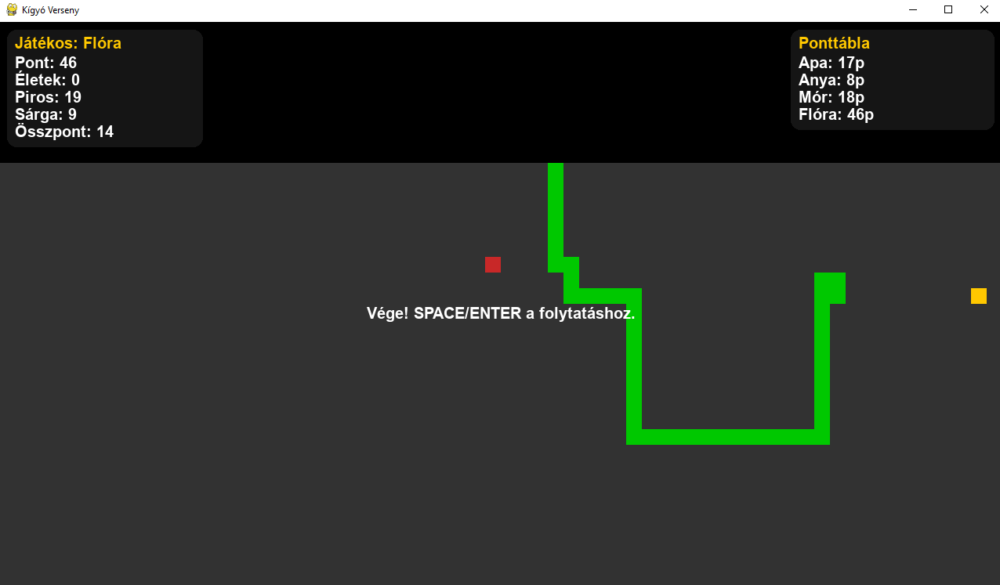

# Snake – Multiplayer Snake Game Based on Pygame

This is a multiplayer snake game created using the [Pygame](https://www.pygame.org/news) library. Players take turns controlling the snake to eat food, grow longer, and avoid collisions. The game features a comprehensive tournament system with detailed statistics tracking and CSV data logging.

---

## 🕹️ Gameplay

- **Player Setup**: At the start, up to 4 players enter their names (no duplicates or empty names allowed)
- **Turn-based Play**: Each player takes turns controlling the snake to earn as many points as possible
- **Food Types**: 
  - **Red food**: Regular food that increases snake length by 1 and awards 1 point
  - **Yellow food**: Special food that appears randomly (1% chance each frame), increases length by 3, awards 3 points, and disappears after 3-9 seconds
- **Life System**: Each player starts with 3 lives; collisions with walls or self cause life loss
- **Scoring**: Points are accumulated across multiple rounds, with total scores tracked
- **Tournament**: The game maintains win statistics across sessions, determining overall champions

---

## 🎮 Controls

- **Arrow Keys**: Control snake direction (Up, Down, Left, Right)
- **Space/Enter**: Continue to next player after game over
- **Window**: Resizable game window that adapts the play area

---

## 🧱 Structure

- **Resizable Pygame Window**: Dynamic game field with modern HUD displaying comprehensive statistics
- **HUD Features**:
  - **Left Card**: Current player statistics (points, lives, red/yellow food eaten, total score)
  - **Right Card**: Live scoreboard showing all players' current points
  - **Transparent overlay cards** with rounded corners for modern appearance
- **Game Areas**:
  - **HUD Zone** (top 180px): Statistics and player information
  - **Play Area** (below HUD): Snake movement and food spawning area
- **Data Persistence**:
  - **JSON savegame** (`savegame.json`): Tournament results and win counts
  - **CSV logging** (`scores.csv`): Detailed run statistics with timestamps
  - **Pandas analysis** (`analyze_scores_pandas.py`): Data analysis and visualization

---

## 📊 Advanced Statistics

The game includes comprehensive data tracking and analysis:

### CSV Data Logging
Each game session logs detailed statistics:
- Player name and timestamp
- Score and snake length achieved
- Lives remaining at end
- Tournament name
- Red and yellow food eaten counts
- Session duration in seconds

### Data Analysis Features
- **Daily summaries** with cumulative scores
- **Rolling averages** (3-day window) for trend analysis
- **Visualization** of player progress over time
- **Export capabilities** for further analysis

---

## 🛠️ Installation & Running

### Requirements

- [Python 3](https://www.python.org/)
- [Pygame](https://www.pygame.org/news)
- [Pandas](https://pandas.pydata.org/) (for data analysis)
- [Matplotlib](https://matplotlib.org/) (for charts)

Install dependencies with pip:

```bash
pip install pygame pandas matplotlib
```

### Running the game

Save the main file as `snake.py`, then run:

```bash
python snake.py
```

### Data Analysis

Run the analysis script to view statistics:

```bash
python analyze_scores_pandas.py
```

This generates:
- `scores_daily_with_trends.csv`: Processed daily statistics
- Interactive charts showing cumulative scores over time

---

## 🧠 Features Overview

- **Multiplayer Support**: Up to 4 players with unique name validation
- **Advanced Food System**: Regular and special food with different point values and behaviors
- **Dynamic Difficulty**: Yellow food with random appearance and disappearance timing
- **Comprehensive Statistics**: Real-time HUD with detailed player metrics
- **Data Persistence**: JSON tournament data and CSV run logging
- **Resizable Interface**: Adaptive window sizing with responsive layout
- **Modern UI Design**: Transparent overlay cards with contemporary styling
- **Tournament System**: Cross-session win tracking and championship determination
- **Performance Analytics**: Detailed run analysis with pandas integration
- **Visual Data Representation**: Charts and graphs for player progress tracking

---

## 📁 File Structure

- `snake.py` - Main game executable
- `savegame.json` - Tournament results and game state
- `scores.csv` - Detailed run statistics (auto-generated)
- `analyze_scores_pandas.py` - Data analysis and visualization
- `scores_daily_with_trends.csv` - Processed daily statistics (generated by analysis)

---

## 📷 Screenshot



---

## 📄 License

This project is free to use for learning purposes.

---

**Have fun playing! 🐍**

---

# Snake – Pygame alapú többszemélyes kígyós játék

Ez egy többszemélyes kígyós játék, amelyet a [Pygame](https://www.pygame.org/news) könyvtár segítségével készítettünk. A játékosok felváltva irányítják a kígyót, hogy egyenek, növekedjenek és elkerüljék az ütközéseket. A játék átfogó versenyrendszerrel, részletes statisztikák követésével és CSV adatnaplózással rendelkezik.

---

## 🕹️ Játékmenet

- **Játékos beállítás**: A játék elején akár 4 játékos írja be a nevét (nem lehet duplikátum vagy üres név)
- **Körökre osztott játék**: Minden játékos felváltva irányítja a kígyót, hogy minél több pontot szerezzen
- **Étel típusok**:
  - **Piros étel**: Normál étel, ami 1-gyel növeli a kígyó hosszát és 1 pontot ad
  - **Sárga étel**: Speciális étel, ami véletlenszerűen jelenik meg (1% esély minden képkockában), 3-mal növeli a hosszat, 3 pontot ad, és 3-9 másodperc után eltűnik
- **Élet rendszer**: Minden játékos 3 élettel kezd; a falnak vagy önmagának ütközés életvesztéssel jár
- **Pontozás**: A pontok több körön át halmozódnak, az összpontszám nyomon követve
- **Verseny**: A játék munkameneteken át tartja nyilván a győzelmi statisztikákat, meghatározva az összbajnokot

---

## 🎮 Irányítás

- **Nyilak**: Kígyó irányítása (Fel, Le, Bal, Jobb)
- **Space/Enter**: Folytatás a következő játékossal a játék vége után
- **Ablak**: Átméretezhető játékablak, ami alkalmazkodik a játéktérhez

---

## 🧱 Felépítés

- **Átméretezhető Pygame ablak**: Dinamikus játéktér modern HUD-dal, ami átfogó statisztikákat jelenít meg
- **HUD funkciók**:
  - **Bal kártya**: Aktuális játékos statisztikái (pontok, életek, elfogyasztott piros/sárga ételek, összpontszám)
  - **Jobb kártya**: Élő eredménytábla az összes játékos aktuális pontjaival
  - **Átlátszó overlay kártyák** lekerekített sarkokkal modern megjelenésért
- **Játékterületek**:
  - **HUD zóna** (felső 180px): Statisztikák és játékos információk
  - **Játéktér** (HUD alatt): Kígyó mozgás és étel megjelenési terület
- **Adatmegőrzés**:
  - **JSON mentés** (`savegame.json`): Versenyeredmények és győzelmi számok
  - **CSV naplózás** (`scores.csv`): Részletes futam statisztikák időbélyegekkel
  - **Pandas elemzés** (`analyze_scores_pandas.py`): Adatelemzés és vizualizáció

---

## 📊 Fejlett statisztikák

A játék átfogó adatkövetést és elemzést tartalmaz:

### CSV adatnaplózás
Minden játékmenet részletes statisztikákat naplóz:
- Játékos neve és időbélyeg
- Elért pontszám és kígyóhossz
- Hátralévő életek a végén
- Verseny neve
- Elfogyasztott piros és sárga ételek száma
- Munkamenet időtartama másodpercekben

### Adatelemzési funkciók
- **Napi összegzések** kumulált pontszámokkal
- **Gördülő átlagok** (3 napos ablak) trendelemzéshez
- **Vizualizáció** a játékosok fejlődéséről időben
- **Export lehetőségek** további elemzéshez

---

## 🛠️ Telepítés és futtatás

### Követelmények

- [Python 3](https://www.python.org/)
- [Pygame](https://www.pygame.org/news)
- [Pandas](https://pandas.pydata.org/) (adatelemzéshez)
- [Matplotlib](https://matplotlib.org/) (diagramokhoz)

Függőségek telepítése pip-pel:

```bash
pip install pygame pandas matplotlib
```

### A játék futtatása

Mentse a fő fájlt `snake.py` néven, majd futtassa:

```bash
python snake.py
```

### Adatelemzés

Futtassa az elemző szkriptet a statisztikák megtekintéséhez:

```bash
python analyze_scores_pandas.py
```

Ez generálja:
- `scores_daily_with_trends.csv`: Feldolgozott napi statisztikák
- Interaktív diagramok a kumulált pontszámok időbeli alakulásáról

---

## 🧠 Funkciók összefoglalása

- **Többjátékos támogatás**: Akár 4 játékos egyedi név validációval
- **Fejlett étel rendszer**: Normál és speciális ételek különböző pontértékekkel és viselkedéssel
- **Dinamikus nehézség**: Sárga étel véletlenszerű megjelenéssel és eltűnési időzítéssel
- **Átfogó statisztikák**: Valós idejű HUD részletes játékos metrikákkal
- **Adatmegőrzés**: JSON verseny adatok és CSV futam naplózás
- **Átméretezhető felület**: Adaptív ablakméretezés reszponzív elrendezéssel
- **Modern UI dizájn**: Átlátszó overlay kártyák kortárs stílussal
- **Versenyrendszer**: Munkameneteken átívelő győzelmi követés és bajnokság meghatározás
- **Teljesítmény analitika**: Részletes futamelemzés pandas integrációval
- **Vizuális adatábrázolás**: Diagramok és grafikonok a játékosok fejlődésének nyomon követéséhez

---

## 📁 Fájlstruktúra

- `snake.py` - Fő játék futtatható fájl
- `savegame.json` - Versenyeredmények és játékállapot
- `scores.csv` - Részletes futam statisztikák (automatikusan generált)
- `analyze_scores_pandas.py` - Adatelemzés és vizualizáció
- `scores_daily_with_trends.csv` - Feldolgozott napi statisztikák (elemzés által generált)

---

## 📷 Képernyőkép


---

## 📄 Licenc

Ez a projekt tanulási célokra szabadon használható.

---

**Kellemes játékot! 🐍**
